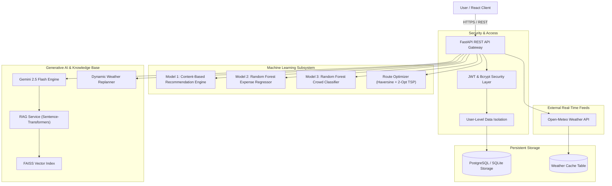

# TripMind System Architecture & Engineering Blueprint

## 1. Executive Architecture Summary
TripMind is a full-stack, enterprise-style travel engineering platform that unifies traditional predictive Machine Learning with Generative AI (LLMs) and grounded Vector Retrieval-Augmented Generation (RAG).

Unlike simplistic wrappers that pass arbitrary user prompts to an LLM, TripMind decouples travel intelligence into specialized, mathematically validated modules:
- **Mathematical Budget & Itemized Forecast:** Handled by a Scikit-Learn **Random Forest Regressor** ($R^2 = 0.9829$) with rigorous backend sanity validation.
- **Content-Based Destination Ranking:** Evaluated using multi-attribute cosine similarity, TF-IDF feature space, and ranking metrics ($NDCG@5 = 1.0$).
- **Tourist Footfall Dynamics:** Predicted by a **Random Forest Classifier** ($Accuracy = 78.5\%$).
- **Grounded Fact Retrieval:** Powered by **Sentence Transformers** (`all-MiniLM-L6-v2`) and a **FAISS** vector database indexing curated destination knowledge.
- **Itinerary Generation & Dynamic Replanning:** Synthesized by **Google Gemini 2.5 Flash** (with resilient algorithmic fallback) producing strict Pydantic-validated JSON.
- **Route Optimization:** Built on Haversine spherical distance matrices and a **Greedy Nearest-Neighbor + 2-Opt local search improvement** heuristic.

---

## 2. High-Level Architecture Flow

---

## 3. Subsystem Breakdown

### 3.1 Frontend Layer
- **Framework:** React.js 18 + Vite 6
- **Styling:** Tailwind CSS with deep navy, cyan, and slate glassmorphism design tokens
- **Visualizations:** Recharts (`ResponsiveContainer`, `PieChart`, `Cell`, `Tooltip`)
- **Interactive Mapping:** Leaflet + OpenStreetMap engine rendering customized SVG numbered pins, popups, and route polylines
- **State & Context:** Modular React Context (`AuthContext`) handling token persistence and user state

### 3.2 Backend Service Layer
- **Framework:** FastAPI with Python 3.11
- **Validation:** Pydantic V2 schemas with strict typing
- **ORM:** SQLAlchemy with declarative mappings, cascade deletions, foreign key indexes, and JSON column support
- **Database Engine:** Dual-mode architecture (SQLite zero-dependency local development + PostgreSQL production ready via Docker Compose)

### 3.3 Dynamic Weather Replanning Architecture
When an adverse weather condition (e.g. heavy rainfall, monsoon alert) is detected or simulated:
1. The backend inspects scheduled activities on the target day.
2. It filters out items where `is_outdoor == True`.
3. It queries the destination dataset and FAISS knowledge base for indoor, weather-safe alternatives (museums, indoor cultural pavilions, tea tasting lounges, sheltered monuments).
4. Gemini or the algorithmic planner reconstructs the day's timeline with updated duration and entry charges.
5. The revised schedule is validated by Pydantic, recalculated in the backend, and rendered with an alert badge in the UI.

---

## 4. Security & Isolation Model
- Passwords are salt-hashed using **Bcrypt (12 rounds)**.
- Authentication tokens are **HMAC-SHA256 (HS256) JWTs** with 24-hour expiration.
- User data isolation is enforced at the database query level: users cannot view, modify, or delete another traveler's private trips or chat histories.
